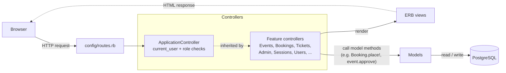
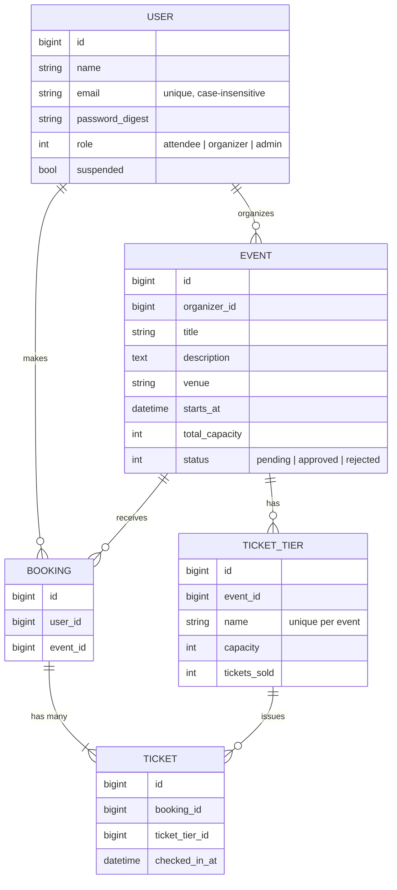

# BookMyEvent — Design Document

BookMyEvent is a Ruby on Rails web application for publishing events and booking tickets.
There are three kinds of users:

- **Attendees** browse published events, book tickets and view their tickets.
- **Organizers** create events and define ticket tiers (e.g. General, VIP).
- **Admins** review events (approve / reject) and view all user accounts.

**Tech stack:** Ruby on Rails 8.1, PostgreSQL, server-rendered ERB views, `bcrypt` (`has_secure_password`) for authentication, RSpec + Cucumber for tests, GitHub Actions for CI (`.github/workflows/ci.yml`), and Render for CD.

---

## 1. System architecture

The app follows the standard Rails **Model–View–Controller** structure. Business rules live in the models and the database, controllers handle authorization and HTTP, and views are plain server-rendered templates.

### Request flows

Every request follows the same path: **route → controller (`current_user`, plus a role check where the page needs one, from `ApplicationController`) → model → view**. The main flows:

| Flow | Request | Controller#action | Model work | Result |
|---|---|---|---|---|
| Home | `GET /` | `HomeController#index` | — | landing page |
| Sign up | `POST /signup` | `UsersController#create` | create `User` (attendee / organizer) | logged in, home page |
| Log in / out | `POST /login`, `DELETE /logout` | `SessionsController` | `User.authenticate_by` | session started / cleared |
| Browse events | `GET /events`, `GET /events/:id` | `EventsController#index`, `#show` | `Event.approved.upcoming`, `visible_to?` | events list / event page |
| Create / edit event | `POST /events`, `PATCH /events/:id` | `EventsController#create`, `#update` | create saves `Event` as `pending`; update keeps its status | event edit page |
| Manage ticket tiers | `POST /events/:id/tiers`, `PATCH/DELETE /events/:id/tiers/:tier_id` | `TicketTiersController` | save / delete `TicketTier` | event edit page |
| Approve / reject event | `PATCH /events/:id/approve`, `/reject` | `EventsController#approve`, `#reject` | `event.approve` / `event.reject` | pending events list |
| Book tickets | `POST /bookings` | `BookingsController#create` | `Booking.place!` | My Tickets (or event page with error) |
| View my tickets | `GET /my-tickets` | `TicketsController#index` | user's bookings with tickets | My Tickets page |
| My account | `GET /account` | `HomeController#account` | organizer's events | account page |
| Admin overview | `GET /admin`, `/admin/users`, `/admin/events/*` | `AdminController` | counts, users, events by status | admin pages |

### 1.1 Data model

### 1.2 Models (`app/models`)

| Model | Responsibility |
|---|---|
| `User` | Account and role (`attendee`, `organizer`, `admin`). Secure password, normalized unique email, `suspended` flag. Has organized events, bookings, and tickets through bookings. |
| `Event` | An event created by an organizer. Status lifecycle `pending → approved / rejected` (`approve`, `reject`). Visibility rule `visible_to?(user)`: approved events are public; others are visible only to their organizer and admins. Validates future start time, and that tier capacities fit in `total_capacity`. |
| `TicketTier` | A category of seats for an event (e.g. VIP). Tracks `capacity` and `tickets_sold`; exposes `seats_left` and `sold_out?`. Tier capacities may not exceed the event capacity, and capacity can't drop below tickets already sold. |
| `Booking` | One checkout by one attendee for one event. Belongs to a user and an event, and **has many tickets** — one per seat booked, possibly across several tiers (e.g. 2 General + 1 VIP = 3 tickets). `Booking.place!` is the single entry point for buying tickets. Its `id` is the user-facing **Booking ID**. |
| `Ticket` | One seat. Belongs to a booking and a tier; its `id` (shown as `ticket_code`, e.g. `#00042`) is the user-facing **Ticket ID**. Validates that its tier belongs to the booking's event. `checked_in_at` is reserved for future check-in. |

### 1.3 Controllers (`app/controllers`)

| Controller | Responsibility |
|---|---|
| `ApplicationController` | `current_user` from the session (suspended users are logged out); role filters `logged_in_only`, `attendee_only`, `organizer_only`, `admin_only`. |
| `UsersController` | Sign up. Role is checked against an allowlist (`attendee`, `organizer`) — admins can't self-register. |
| `SessionsController` | Log in / log out; login is rate-limited (10 attempts / 3 min). |
| `HomeController` | Landing page and **My account** (organizers see their events here). |
| `EventsController` | Public list of approved upcoming events and event pages; organizers create / edit their own events; admins `approve` / `reject`. |
| `TicketTiersController` | Organizers add / edit / delete tiers on their own events; a tier with sold tickets can't be deleted. |
| `BookingsController` | Turns the booking form into a call to `Booking.place!` and reports success or errors. |
| `TicketsController` | **My Tickets**: an attendee's bookings with their Ticket IDs. |
| `AdminController` | Dashboard with counts, user list, and pending / published / rejected event lists. |

### 1.4 Main interactions

- **Event lifecycle:** organizer creates event (`pending`) → adds tiers → admin approves (`approved`, now public and bookable) or rejects (`rejected`). Status can only change while `pending`, and the change happens under a row lock so two admins can't act on the same event at once.
- **Booking:** attendee opens an approved event → picks quantities per tier → `BookingsController#create` → `Booking.place!` creates one `Booking` and one `Ticket` per seat, and increments each tier's `tickets_sold` → redirect to My Tickets.

---

## 2. User interface design

> The visual design has not been planned yet. The current UI is plain, unstyled HTML; this section records the page structure and workflows, and mock-ups will be added later.

### 2.1 Pages

| Page | URL | Who | Contents |
|---|---|---|---|
| Home | `/` | Everyone | Welcome, links to events / login / sign up |
| Sign up / Log in | `/signup`, `/login` | Guests | Forms; sign-up lets you pick Attendee or Organizer |
| Events | `/events` | Everyone | Approved, upcoming events |
| Event page | `/events/:id` | Depends on status | Details, tier table with seats left / "Sold Out", booking form (attendees) or status + approve / reject (admins) |
| New / edit event | `/events/new`, `/events/:id/edit` | Owning organizer | Event form and tier management |
| My account | `/account` | Logged in | Profile; organizers see their events and statuses |
| My Tickets | `/my-tickets` | Attendees | Bookings, newest first, with Ticket IDs |
| Admin | `/admin`, `/admin/users`, `/admin/events/{pending,published,rejected}` | Admins | Summary counts, user list, event review lists |

The navigation bar changes by role: everyone sees **BookMyEvent** (home) and **Events**; guests also see **Sign up** and **Log in**; logged-in users see **My account** and **Log out**, plus **My Tickets** (attendees), **Create event** (organizers) or **Admin dashboard** (admins).

### 2.2 Key workflows

1. **Organizer publishes an event:** sign up as organizer → Create event → add ticket tiers → wait for approval (status shown on My account).
2. **Admin reviews:** Admin dashboard → Events awaiting approval → Approve or Reject (directly in the list, or from the event page).
3. **Attendee books:** Events → open event → choose quantities in one or more tiers → Book → My Tickets shows the Booking ID and one Ticket ID per seat. Sold-out tiers show "Sold Out" instead of a quantity box.

### 2.3 Mock-ups

_To be added._

---

## 3. Design decisions and trade-offs

### 3.1 Preventing overselling (race conditions)
Two attendees can try to buy the last seat at the same moment. `Booking.place!` runs in one database transaction and locks the selected tier rows (`SELECT … FOR UPDATE`), re-checks `seats_left` while holding the lock, then writes the tickets and updates `tickets_sold`. Tiers are always locked in `id` order so concurrent bookings can't deadlock. As a last line of defence, a database check constraint enforces `tickets_sold <= capacity`.
*Trade-off:* bookings for the same tier are processed one after another, which is fine at this scale and far simpler than a reservation/hold system.

### 3.2 All-or-nothing multi-tier bookings
If one tier in a request doesn't have enough seats, the whole booking is rolled back and no seats are taken from the other tiers. This keeps a booking consistent, at the cost of the user having to adjust and resubmit.

### 3.3 Booking vs. Ticket
A **Booking** groups one checkout; a **Ticket** is one seat. This gives each seat its own Ticket ID (needed for future check-in) while still showing purchases as a single order. Tickets reach their user through the booking rather than storing `user_id` twice, so the two can't disagree.

### 3.4 Database IDs as Booking / Ticket IDs
We use the auto-increment primary keys (formatted, e.g. `#00042`) instead of generating random codes. They are guaranteed unique and need no extra column. *Trade-off:* they are sequential and guessable, so they must never be the only thing that grants access. My Tickets only ever loads the logged-in user's own bookings. A random public code can be added later if needed.

### 3.5 Denormalized `tickets_sold` counter
Each tier stores `tickets_sold` instead of counting ticket rows every time. This makes "seats left" a cheap read and gives a single row to lock during booking. The counter is only changed inside `Booking.place!` and is protected by the check constraint.

### 3.6 Admin approval before publishing
New events start as `pending` and are hidden from attendees (404) until an admin approves them. Organizers can't set the status themselves (it is never taken from the form). This adds a review step but stops unreviewed events from being sold.

### 3.7 Admin accounts
Admin accounts can't be created through sign-up (only attendee and organizer can be chosen). For now, the admin account is created from `db/seeds.rb` (`bin/rails db:seed`).

### 3.8 Server-rendered HTML
Pages are rendered by Rails (ERB + Turbo) rather than a separate JavaScript front end. This keeps one codebase and makes behaviour easy to test with request specs and Cucumber, at the cost of a less dynamic UI for now.
